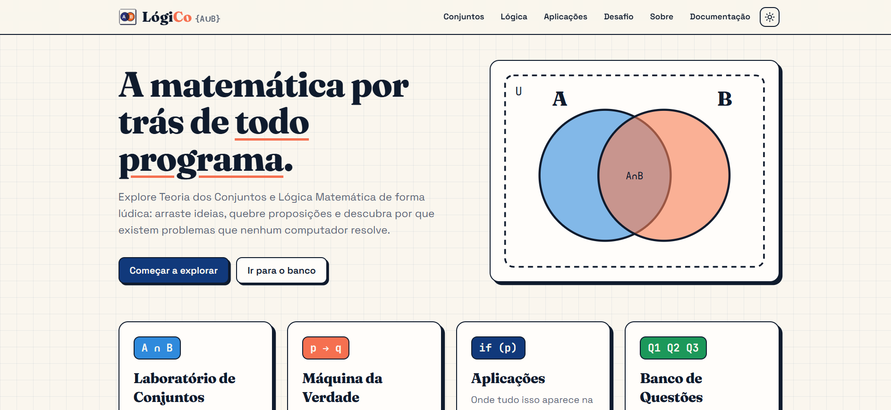
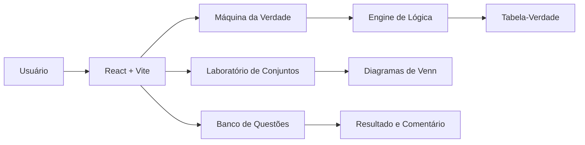
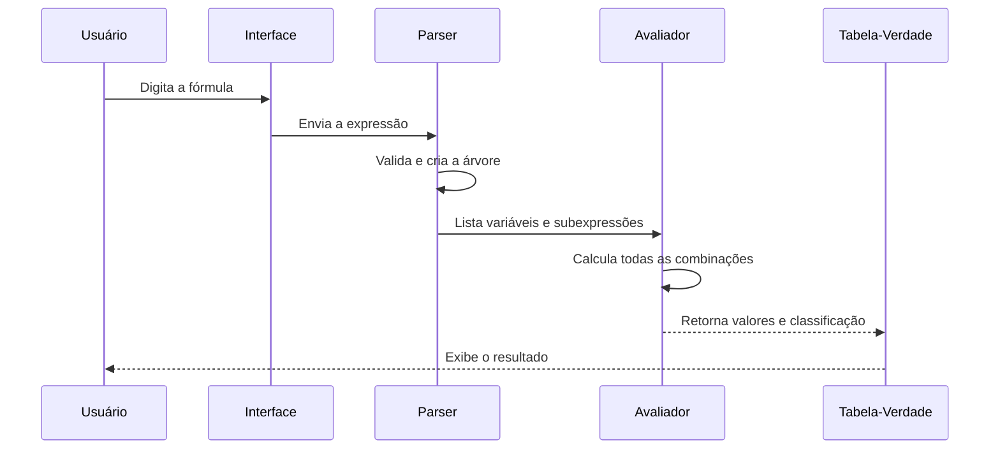

<p align="center"><a href="https://logicomatematica.vercel.app/" target="_blank"></a></p>

<p align="center">
<a href="https://github.com/Carlos2505dev/ModelagemSimulacao"></a>
<a href="https://github.com/Carlos2505dev/ModelagemSimulacao"></a>
<a href="https://github.com/Carlos2505dev/ModelagemSimulacao"></a>
</p>

<p align="center">
<a href="https://skillicons.dev">
  
</a>
</p>

## Sobre o Projeto

**A lógica parece abstrata até virar ferramenta.**

O problema é comum: conceitos como conjuntos, proposições e tabelas-verdade são apresentados por fórmulas e exercícios desconectados da prática. Sem experimentar o raciocínio, o estudante memoriza símbolos sem entender o que eles representam.

O **LógiCo** transforma Teoria dos Conjuntos e Lógica Matemática em experiências interativas. Você monta conjuntos, visualiza operações em diagramas de Venn, gera tabelas-verdade, compara fórmulas, acompanha consistência de requisitos e treina em um banco de questões comentado.

O projeto foi desenvolvido como **AV3 da disciplina de Modelagem e Simulação Matemática**, do curso de Engenharia da Computação da Universidade Jorge Amado, sob orientação do professor Marcelo Lopes.

> O objetivo não é substituir aulas ou professores. O objetivo é tornar conceitos matemáticos visíveis, manipuláveis e aplicáveis em problemas reais da computação.

**Experimente:** [Abrir o LógiCo](https://logicomatematica.vercel.app/) · sem criar conta

## ✨ O que o Projeto faz

A plataforma hoje reúne:

| Recurso | O que resolve | Status |
| ------- | ------------- | ------ |
| **Laboratório de Conjuntos** | Visualiza união, interseção, diferença, complemento e diagramas de Venn | ✅ Pronto |
| **Máquina da Verdade** | Gera tabelas-verdade e classifica fórmulas automaticamente | ✅ Pronto |
| **Equivalências Lógicas** | Compara fórmulas e aplica propriedades como De Morgan | ✅ Pronto |
| **Quantificadores** | Explica quantificação universal, existencial e variáveis livres | ✅ Pronto |
| **Aplicações na Computação** | Relaciona lógica e conjuntos com software, bancos de dados e circuitos | ✅ Pronto |
| **Banco de Questões** | Treina 35 questões por tema e nível de dificuldade | ✅ Pronto |
| **Simulado** | Permite sorteio de questões, cronômetro e acompanhamento de acertos | ✅ Pronto |
| **Documentação Oficial** | Disponibiliza o PDF acadêmico e resume os fundamentos do projeto | ✅ Pronto |
| **Caderno de Fórmulas** | Guarda fórmulas favoritas no navegador | ✅ Pronto |
| **Autenticação** | Sincronização de progresso entre dispositivos | 🗺️ Planejado |

<details>
<summary><strong>📋 Ver todos os recursos</strong></summary>

### Laboratório de Conjuntos

* Definição de universo U e dos conjuntos A e B
* União, interseção, diferenças e diferença simétrica
* Complementos em relação ao universo
* Diagramas interativos para dois conjuntos
* Inclusão-exclusão e diagrama com três conjuntos
* Presets de números, linguagens e vogais

### Máquina da Verdade

* Negação, conjunção, disjunção, condicional e bicondicional
* Avaliação automática de subexpressões
* Classificação em tautologia, contradição ou contingência
* Equivalências e consistência de especificações
* Tradução de requisitos para proposições
* Demonstrações, argumentos e quantificadores

### Banco de Questões

* Filtros por tema e dificuldade
* Respostas com gabarito comentado
* Opção de refazer questões
* Simulado com quantidade configurável
* Modo duelo e controle de tempo
* Compatível com uso em navegador e dispositivo móvel

### Conteúdo

* Princípios da identidade, não contradição e terceiro excluído
* Linguagem proposicional e sentenças abertas
* Conectivos lógicos e tabelas-verdade
* Pertinência, inclusão e operações entre conjuntos
* Limites da computação e cardinalidade
* Relação entre lógica, circuitos digitais e código

</details>

## 🎬 Demonstração

<p align="center">
  <a href="https://logicomatematica.vercel.app/" target="_blank">
    
  </a>
</p>

<div style="display:flex;gap:14px;border-left:4px solid hsl(224 75% 50%);padding:12px 16px;border-radius:6px;background:transparent;align-items:flex-start">
  <div style="flex:0 0 44px;display:flex;align-items:center;justify-content:center">
    <div style="width:36px;height:36px;border-radius:8px;background:hsl(224 75% 95%);display:flex;align-items:center;justify-content:center;color:hsl(224 75% 50%);font-weight:700">
      i
    </div>
  </div>
  <div style="min-width:0">
    <div style="font-weight:600;color:hsl(224 75% 46%);margin-bottom:4px">Importante</div>
    <div>O LógiCo roda diretamente no navegador, sem instalação ou criação de conta. Algumas preferências e fórmulas favoritas podem ser guardadas localmente no dispositivo.</div>
  </div>
</div>

## 📦 Instalação

### Pré-requisitos

```text
Node.js >= 18
npm, yarn ou bun
```

### Instalação

```bash
git clone https://github.com/Carlos2505dev/ModelagemSimulacao.git

cd ModelagemSimulacao

npm install
# ou
bun install

npm run dev
```

Abra:

```text
http://localhost:2029
```

A porta é configurada como fixa no arquivo `vite.config.ts`. Se ela já estiver ocupada, o servidor não tentará escolher outra porta automaticamente.

## 🚀 Primeiros Passos

### 1. Explore os conjuntos

Abra o **Laboratório de Conjuntos**, altere U, A e B e selecione uma operação. O diagrama de Venn e o resultado serão atualizados.

### 2. Use a Máquina da Verdade

Na página **Lógica**, digite uma expressão como `p → q` ou `¬(p ∧ q) ↔ (¬p ∨ ¬q)` e gere a tabela completa.

### 3. Relacione teoria e computação

No módulo **Aplicações**, confira exemplos de circuitos digitais, código, bancos de dados, requisitos e limites do computador.

### 4. Treine no banco de questões

Escolha tema e dificuldade no **Banco de Questões**, responda o quiz ou configure um simulado.

A partir daí:

```text
Estudar os fundamentos
    ↓
Manipular conjuntos e proposições
    ↓
Comparar e classificar fórmulas
    ↓
Relacionar com aplicações reais
    ↓
Responder questões comentadas
    ↓
Acompanhar acertos no simulado
```

## 🧠 Como Funciona

Um exemplo concreto. Na Máquina da Verdade, uma fórmula é interpretada e todas as combinações possíveis dos valores V e F são avaliadas:

```text
p → q

p = V, q = V  →  V
p = V, q = F  →  F
p = F, q = V  →  V
p = F, q = F  →  V
```

A fórmula é analisada pelo módulo de lógica compartilhado pela interface e pelos recursos educacionais:

```ts
import { classify, evaluate, parse, rows } from "@/lib/logic";

const formula = parse("p → q");
const result = rows(["p", "q"]).map((environment) =>
  evaluate(formula, environment),
);

// → [true, false, true, true]
// Classificação: contingência
```

O parser separa a expressão, gera subexpressões, combina os valores das variáveis e calcula o resultado final. Os componentes exibem o cálculo em tabelas, diagramas e exemplos de aplicação:



<details>
<summary><strong>🏗️ Detalhes da arquitetura</strong></summary>

### Componentes

| Componente | Responsabilidade |
| ---------- | ---------------- |
| `src/routes` | Páginas, conteúdos e roteamento |
| `src/components` | Componentes visuais compartilhados |
| `src/lib/logic.ts` | Parser e avaliação de fórmulas lógicas |
| `src/lib/favoritas.ts` | Persistência de fórmulas favoritas |
| `src/lib/error-reporting.ts` | Utilitários de relatório de erros |
| `src/styles.css` | Tema, tokens e estilos globais |
| `Materiais/` | Apresentações, avaliação e documentação PDF |

### Fluxo de uma fórmula lógica



### Decisão: React + TanStack Router

React foi utilizado para componentes interativos e atualizações visuais reativas. TanStack Router organiza as páginas e permite parâmetros de busca para abrir módulos com exemplos pré-carregados.

### Decisão: TypeScript

O projeto utiliza TypeScript para reforçar contratos de dados em fórmulas, estados, questões e resultados. Isso reduz erros silenciosos e facilita a manutenção.

</details>

## 🗂️ Estrutura do Projeto

```text
marcelomodelagem/
├── Materiais/
│   ├── AVALIAÇÃO 03- MODELAGEM E SIMULAÇAO MATEMÁTICA-3.docx
│   ├── Documentação.pdf
│   └── Aulas em PowerPoint
├── public/
│   ├── Unijorge.png
│   ├── favicon.ico
│   ├── robots.txt
│   └── team/
├── src/
│   ├── components/
│   ├── hooks/
│   ├── lib/
│   │   ├── logic.ts
│   │   ├── favoritas.ts
│   │   └── utils.ts
│   ├── routes/
│   │   ├── index.tsx
│   │   ├── conjuntos.tsx
│   │   ├── logica.tsx
│   │   ├── aplicacoes.tsx
│   │   ├── quiz.tsx
│   │   ├── documentacao.tsx
│   │   └── sobre.tsx
│   ├── main.tsx
│   ├── router.tsx
│   └── styles.css
├── index.html
├── package.json
├── tsconfig.json
├── vite.config.ts
├── vitest.config.ts
└── README.md
```

<details>
<summary><strong>📁 Explicação da estrutura</strong></summary>

| Caminho | Objetivo |
| ------- | -------- |
| `src/routes` | Páginas principais e configuração de cada rota |
| `src/components` | Componentes reutilizáveis e efeitos visuais |
| `src/lib/logic.ts` | Parser, variáveis, avaliação e classificação lógica |
| `src/lib/favoritas.ts` | Caderno local de fórmulas |
| `src/hooks` | Hooks reutilizáveis da aplicação |
| `public/team` | Fotos da equipe apresentada na página Sobre |
| `Materiais` | Materiais acadêmicos usados no desenvolvimento |
| `vite.config.ts` | Servidor de desenvolvimento, porta e build |

### Arquitetura

O LógiCo adota uma arquitetura centrada em componentes e módulos compartilhados:

| Camada | Diretórios | Responsabilidade |
| ------ | ---------- | ---------------- |
| **Apresentação** | `src/routes`, `src/components` | Interface, navegação e experiência visual |
| **Domínio** | `src/lib/logic.ts` | Leitura, cálculo e classificação de fórmulas |
| **Estado** | Hooks e estados locais | Interações de páginas e recursos temporários |
| **Persistência** | `src/lib/favoritas.ts` | Armazenamento local de preferências |
| **Conteúdo** | `src/routes/quiz.tsx`, `Materiais` | Questões, documentação e materiais acadêmicos |

**Por que essa arquitetura?**

- **Manutenibilidade:** páginas e regras matemáticas podem evoluir separadamente.
- **Testabilidade:** a lógica pode ser validada diretamente pela suíte Vitest.
- **Reutilização:** componentes visuais e utilitários são compartilhados entre páginas.
- **Separation of concerns:** interface, conteúdo e cálculo não ficam misturados.

</details>

## ⚙️ Configurações Avançadas

<details>
<summary><strong>🔧 Servidor e porta</strong></summary>

O servidor de desenvolvimento e o preview estão configurados em `localhost:2029`:

```ts
server: {
  host: "localhost",
  port: 2029,
  strictPort: true,
  open: true,
}
```

Para alterar a porta, edite `vite.config.ts` e atualize o endereço mostrado neste README.

</details>

<details>
<summary><strong>🧪 Lint e build</strong></summary>

Lint:

```bash
npm run lint
```

Type-check:

```bash
npx tsc --noEmit
```

Build de produção:

```bash
npm run build
```

Preview do build:

```bash
npm run preview
```

</details>

</details>

## ⚠️ Limitações técnicas conhecidas

Estas limitações descrevem o comportamento atual da plataforma:

| Área | Limitação atual |
| ---- | --------------- |
| **Persistência** | Fórmulas favoritas e preferências são armazenadas no dispositivo pelo navegador. Não há sincronização automática entre dispositivos. |
| **Conta e autenticação** | O projeto não exige login e ainda não possui autenticação ou perfis de usuário. |
| **Limite de expressões** | A Máquina da Verdade limita a análise a cinco variáveis para evitar crescimento excessivo da tabela. |
| **Parser lógico** | O resolvedor aceita símbolos e atajos definidos pelo projeto; não é um provador automático simbólico completo. |
| **Backend** | A aplicação não possui servidor próprio de dados ou banco de dados remoto. |
| **Cálculo didático** | Os resultados têm finalidade educacional e devem ser usados como apoio ao estudo. |

## 📚 Documentação

| Documento | Descrição |
| --------- | --------- |
| [README](./README.md) | Visão geral do projeto |
| [Documentação oficial](./Materiais/Documentação.pdf) | PDF acadêmico da AV3 |
| [Página de documentação](./src/routes/documentacao.tsx) | Interface da documentação no aplicativo |
| [Aplicações](./src/routes/aplicacoes.tsx) | Relações entre lógica, conjuntos e computação |
| [Página Sobre](./src/routes/sobre.tsx) | Equipe, instituição e objetivos |

## 🤝 Contribuindo

Contribuições são bem-vindas:

1. Faça um fork do projeto
2. Crie sua Feature Branch (`git checkout -b feature/AmazingFeature`)
3. Commit suas mudanças (`git commit -m 'Adiciona AmazingFeature'`)
4. Faça push para a Branch (`git push origin feature/AmazingFeature`)
5. Abra um Pull Request

Antes de contribuir, mantenha a nomenclatura existente, use componentes reutilizáveis e execute lint, testes e build.

## 🐛 Reportando Problemas

Abra uma [Issue](https://github.com/Carlos2505dev/ModelagemSimulacao/issues/new) contendo:

```text
### Descrição

Explique o problema.

### Como reproduzir

1. ...
2. ...
3. ...

### Resultado esperado

...

### Ambiente

- Sistema operacional:
- Navegador:
- Versão do projeto:
```

## ❓ FAQ

<details>
<summary><strong>O LógiCo é gratuito?</strong></summary>

Sim. O projeto pode ser executado localmente ou estudado diretamente pelo repositório, sem conta obrigatória.

</details>

<details>
<summary><strong>Preciso instalar algum software para usar o projeto desenvolvido?</strong></summary>

Para usar a aplicação pelo navegador em desenvolvimento, é necessário ter Node.js e um gerenciador de pacotes. O projeto não exige instalação de banco de dados ou serviços externos.

</details>

<details>
<summary><strong>Como uma tabela-verdade é calculada?</strong></summary>

As variáveis são extraídas da expressão, todas as combinações possíveis são geradas e o avaliador aplica os conectivos recursivamente.

</details>

<details>
<summary><strong>Quantas questões existem no banco?</strong></summary>

O banco atual contém 35 questões distribuídas entre conjuntos, conectivos, quantificadores, consistência, demonstrações e tradução.

</details>

<details>
<summary><strong>O projeto substitui o estudo da disciplina?</strong></summary>

Não. O LógiCo é uma ferramenta complementar criada para apoiar a visualização e a prática dos conteúdos.

</details>

<details>
<summary><strong>Meus dados são enviados para terceiros?</strong></summary>

O projeto não possui um backend próprio configurado. Recursos locais dependem do armazenamento do próprio navegador.

</details>

## 📜 Licença

Este projeto acadêmico não possui um arquivo de licença definido no repositório atual.

## 💙 Agradecimentos

Obrigado à equipe que participou da construção do projeto, aos colegas que testaram as interfaces e ao professor Marcelo Lopes pela orientação e avaliação da disciplina.

<div align="center">

  

  <p><em>Transforme abstrações em compreensão prática.</em></p>

  <p>
    <a href="https://github.com/Carlos2505dev/ModelagemSimulacao"></a>
    <a href="https://github.com/Carlos2505dev/ModelagemSimulacao"></a>
  </p>

  <p>
    <a href="https://github.com/Carlos2505dev/ModelagemSimulacao">GitHub</a> •
    <a href="https://logicomatematica.vercel.app/">Aplicação</a>
  </p>

  <p><a href="#readme">⬆ Voltar ao topo</a></p>

</div>
